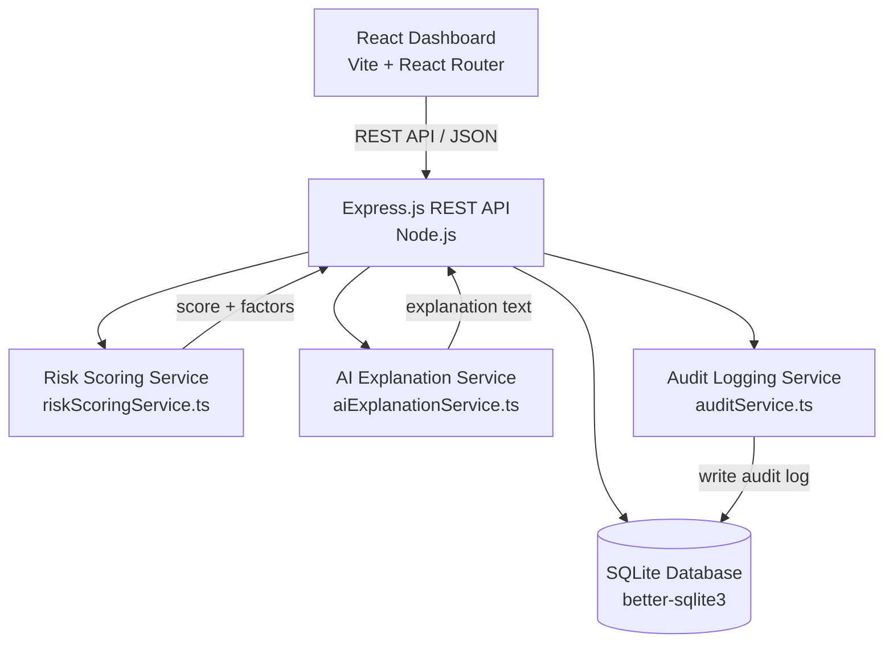
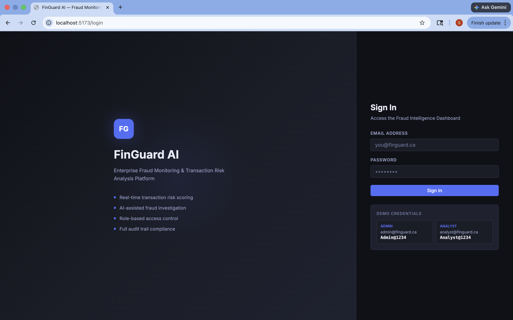
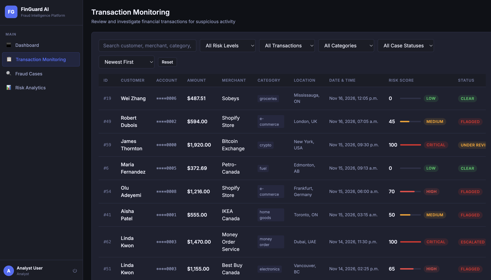
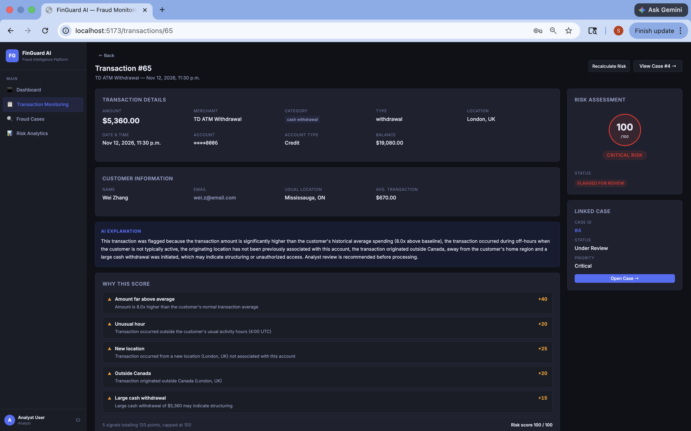
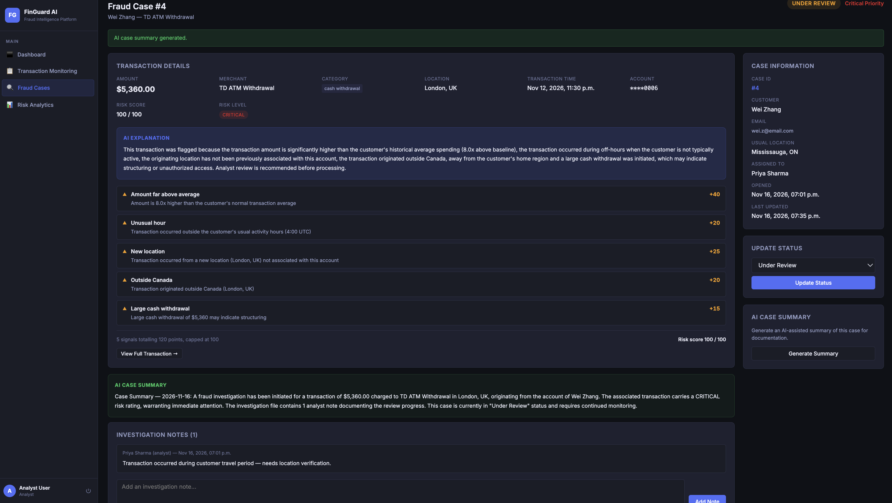
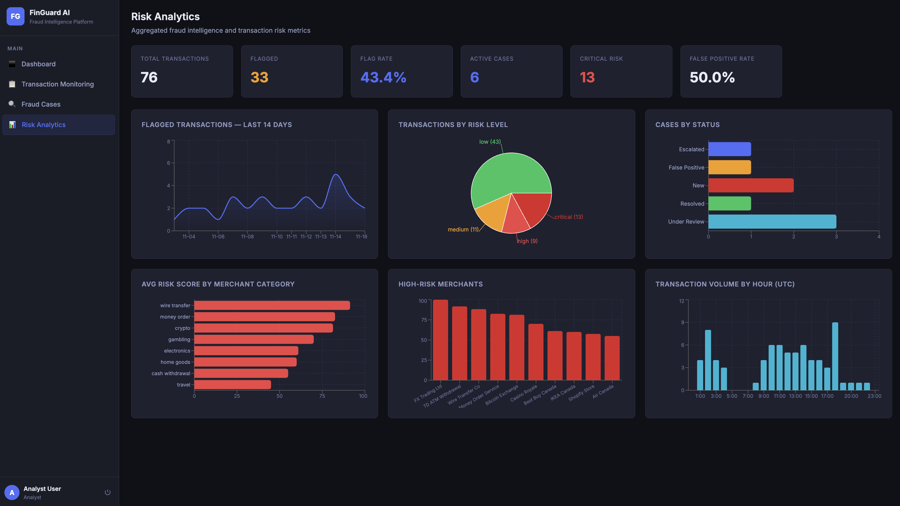
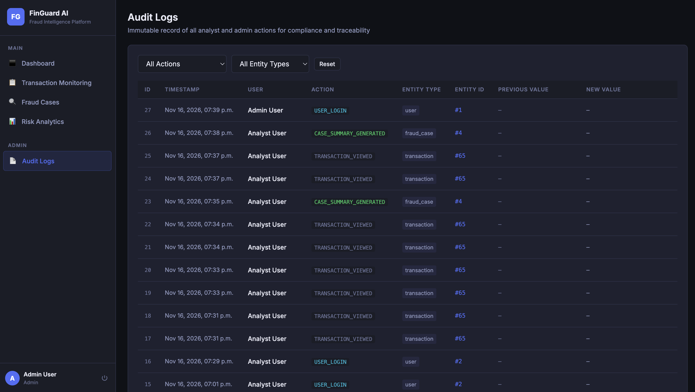

# FinGuard AI — Enterprise Fraud Monitoring Platform

> A full-stack AI-assisted fraud monitoring and transaction risk analysis platform designed for financial institution workflows.

This project simulates how a financial institution might monitor suspicious transactions, assign fraud investigation cases, track audit logs, and use AI-assisted explanations to support analyst decision-making. It was built to demonstrate full-stack development, secure authentication, role-based access control, data analytics, explainable risk scoring, and enterprise-style software design.

---

## Overview

FinGuard AI is an internal fraud intelligence dashboard built for fraud analysts and compliance teams. It allows analysts to review flagged transactions, manage fraud cases, and analyze risk trends through an enterprise-grade UI.

---

## Features

| Feature | Description |
|---------|-------------|
| **Transaction Monitoring** | Real-time table of all transactions with search, filters, pagination, and risk badges |
| **Risk Scoring Engine** | Deterministic rule-based engine combining 8 weighted risk signals into a 0–100 score, with a per-signal points breakdown shown for every transaction |
| **AI Explanation Generator** | Plain-English analyst-style explanations for every flagged transaction |
| **Fraud Case Management** | Full case lifecycle: create, assign, update status, add notes, generate summaries |
| **Role-Based Access Control** | Admin and Analyst roles with JWT authentication and protected routes; roles are checked against the database on every request |
| **Risk Analytics Dashboard** | Recharts visualizations: flagged-by-day, risk-by-category, high-risk merchants, volume-by-hour |
| **Audit Logging** | Append-only log of user actions for compliance and traceability — database triggers reject any update or delete |
| **AI Case Summary** | Generates professional investigation summaries for each fraud case |

---

## Tech Stack

**Language**
- TypeScript end to end (strict mode) — the React client, the Node.js API, and the tests

**Frontend**
- React 18, Vite 8, React Router v7
- Recharts (data visualization)
- Axios (API client)
- Plain CSS with CSS custom properties

**Backend**
- Node.js, Express.js REST API
- SQL on SQLite via better-sqlite3 (embedded database, zero setup)
- JWT (jsonwebtoken) + bcryptjs
- Morgan (request logging)

**Testing**
- Jest + Supertest (run through ts-jest)
- 25 unit and integration tests across risk scoring, auth, access control, audit logging, and transactions

---

## Architecture



---

## Project Structure

```
FinGuard-AI/
├── client/                     # React frontend (Vite)
│   ├── src/
│   │   ├── components/
│   │   │   ├── common/         # ProtectedRoute, AdminRoute, RiskFactors
│   │   │   └── layout/         # Sidebar, AppLayout
│   │   ├── context/            # AuthContext (JWT state)
│   │   ├── pages/              # LoginPage, Dashboard, Transactions, Cases, Analytics, Audit
│   │   ├── services/           # api.ts (typed Axios client + all API calls)
│   │   ├── utils/              # formatters.ts
│   │   └── types.ts            # shapes of the API responses
│   ├── package.json
│   ├── tsconfig.json
│   └── vite.config.ts
│
├── server/                     # Node.js + Express backend
│   ├── src/
│   │   ├── config/             # env.ts (loads .env)
│   │   ├── controllers/        # authController, transactionController, caseController, analyticsController, auditController
│   │   ├── database/           # db.ts, schema.ts, seed.ts
│   │   ├── middleware/         # auth.ts (JWT), errorHandler.ts
│   │   ├── routes/             # auth, transactions, cases, analytics, audit, users
│   │   ├── services/           # riskScoringService.ts, transactionRiskService.ts, aiExplanationService.ts, auditService.ts
│   │   ├── utils/              # request.ts (query parsing, pagination)
│   │   └── types.ts            # database rows and domain types
│   ├── tests/                  # Jest + Supertest tests (run on an in-memory database)
│   │   ├── riskScoring.test.ts
│   │   ├── auth.test.ts
│   │   ├── accessControl.test.ts
│   │   ├── transactions.test.ts
│   │   ├── helpers.ts          # fixtures shared by the integration tests
│   │   └── setupEnv.ts         # test-only environment (secret, in-memory DB)
│   ├── data/                   # SQLite database (auto-created)
│   ├── .env
│   ├── .env.example
│   ├── tsconfig.json
│   └── package.json
│
└── README.md
```

---

## Database Schema

```sql
users           -- id, name, email, password_hash, role, created_at
customers       -- id, name, email, usual_location, average_transaction_amount
accounts        -- id, customer_id, account_number, account_type, balance
transactions    -- id, customer_id, account_id, amount, merchant, category, location,
                --   transaction_type, transaction_time, risk_score, risk_level, flagged, explanation,
                --   risk_factors (JSON: the signals that fired and the points each contributed)
fraud_cases     -- id, transaction_id (unique), assigned_to, status, priority, summary, resolution
case_notes      -- id, case_id, user_id, note, created_at
audit_logs      -- id, user_id, user_name, action, entity_type, entity_id, old_value, new_value
                --   (append-only: BEFORE UPDATE / BEFORE DELETE triggers abort any change)
```

---

## Risk Scoring Logic

The risk scoring engine (`server/src/services/riskScoringService.ts`) is **deterministic and explainable** — no randomness. Eight signals each contribute a fixed weight (the amount signal has two tiers):

| Risk Signal | Points |
|-------------|--------|
| Amount is 3–5× customer average | +25 |
| Amount is 5×+ customer average | +40 |
| Transaction at unusual hour (00:00–05:00 UTC) | +20 |
| Transaction city differs from the customer's usual location | +25 |
| Location outside Canada | +20 |
| Suspicious merchant category (crypto, gambling, wire_transfer, money_order) | +20 |
| High transaction velocity (3+ other transactions in the preceding 60 min) | +30 |
| Large cash withdrawal (≥$5,000) | +15 |
| Round-number amount — a multiple of $500, $1,000 or more (structuring indicator) | +10 |

The points are summed and capped at 100. A transaction is **flagged for review at 31 or above**.

Every scored transaction stores the list of signals that fired and the points each one added (`risk_factors`). The transaction and case pages show that breakdown under "Why This Score", so an analyst can see exactly how the number was reached — the points always add up to the score (or exceed it, when the score is capped at 100).

**Risk Levels:**
- 0–30: `low` — Normal transaction
- 31–60: `medium` — Worth reviewing
- 61–80: `high` — Likely fraud, open a case
- 81–100: `critical` — Immediate investigation required

---

## AI Explanation Feature

`server/src/services/aiExplanationService.ts` generates analyst-readable explanations using triggered risk factors:

> *"This transaction was flagged because the amount is significantly higher than the customer's historical average spending (6.5x above baseline), the transaction occurred during off-hours when the customer is not typically active, and the originating location has not been previously associated with this account."*

**LLM Integration Ready:** The service is structured so an LLM (Claude, GPT-4, etc.) can be dropped in by replacing the rule-based generator with an API call. Integration points are marked with `// TODO: LLM integration point` comments.

---

## Screenshots

**Login** — demo credential tiles



**Transaction Monitoring** — risk score bars and badges



**Transaction Detail** — AI explanation and the per-signal score breakdown



**Fraud Case** — status, assignment, notes and summary



**Risk Analytics** — six interactive charts



**Audit Logs** — admin only



---

## Demo Credentials

| Role | Email | Password |
|------|-------|----------|
| **Admin** | `admin@finguard.ca` | `Admin@1234` |
| **Analyst** | `analyst@finguard.ca` | `Analyst@1234` |

These accounts exist only in the local demo database created by `npm run seed`. All data is synthetic.

---

## Setup Instructions

### Prerequisites
- Node.js v20.19+ or v22.12+ (required by Vite 8)
- npm v9+

### 1. Clone the repository

```bash
git clone https://github.com/Sahibjeet-Sidhu/FinGuard-AI.git
cd FinGuard-AI
```

### 2. Set up the backend

```bash
cd server
npm install

# Create environment file
cp .env.example .env
# Edit .env if needed (defaults work for local development)

# Initialize and seed the database
npm run seed

# Start the development server (runs the TypeScript directly and restarts on changes)
npm run dev
```

The API will run at `http://localhost:3001`

To run the compiled build instead: `npm run build`, then `npm start`.

### 3. Set up the frontend

```bash
cd ../client
npm install
npm run dev
```

The app will open at `http://localhost:5173`

### 4. Run backend tests

```bash
cd server
npm test
```

### 5. Type-check

```bash
cd server && npm run typecheck
cd ../client && npm run typecheck
```

### Environment Variables

**server/.env**

| Variable | Default | Description |
|----------|---------|-------------|
| `PORT` | `3001` | Express server port |
| `HOST` | `localhost` | Interface the API listens on. The default accepts connections from this machine only |
| `JWT_SECRET` | *(set this)* | Secret key for JWT signing |
| `JWT_EXPIRES_IN` | `8h` | JWT token lifetime |
| `CLIENT_URL` | `http://localhost:5173` | CORS allowed origin |
| `NODE_ENV` | `development` | Environment mode |

---

## API Endpoints

### Auth
| Method | Endpoint | Auth | Description |
|--------|----------|------|-------------|
| POST | `/api/auth/register` | — | Register a new analyst. Creating an admin requires an admin's JWT |
| POST | `/api/auth/login` | — | Login, returns JWT |
| GET | `/api/auth/me` | JWT | Get current user |

### Transactions
| Method | Endpoint | Auth | Description |
|--------|----------|------|-------------|
| GET | `/api/transactions` | JWT | List transactions (paginated, filterable) |
| GET | `/api/transactions/:id` | JWT | Transaction detail, including `risk_factors` (the signals and points behind the score) |
| POST | `/api/transactions/:id/recalculate-risk` | JWT | Re-run risk scoring (audited) |

### Fraud Cases
| Method | Endpoint | Auth | Description |
|--------|----------|------|-------------|
| GET | `/api/cases` | JWT | List cases (filter by status, priority, `active=true`, search) |
| GET | `/api/cases/:id` | JWT | Case detail with notes |
| POST | `/api/cases` | JWT | Create case from transaction |
| PUT | `/api/cases/:id/status` | JWT | Update case status |
| PUT | `/api/cases/:id/assign` | Admin | Assign to analyst |
| POST | `/api/cases/:id/notes` | JWT | Add investigation note |
| POST | `/api/cases/:id/generate-summary` | JWT | Generate AI summary |

### Analytics
| Method | Endpoint | Description |
|--------|----------|-------------|
| GET | `/api/analytics/summary` | Summary KPI cards |
| GET | `/api/analytics/risk-levels` | Transactions by risk level |
| GET | `/api/analytics/flagged-by-day` | Flagged transaction trend |
| GET | `/api/analytics/cases-by-status` | Case distribution |
| GET | `/api/analytics/high-risk-merchants` | Top flagged merchants |
| GET | `/api/analytics/volume-by-hour` | Hourly transaction pattern |
| GET | `/api/analytics/avg-risk-by-category` | Risk by category |

### Admin
| Method | Endpoint | Auth | Description |
|--------|----------|------|-------------|
| GET | `/api/audit-logs` | Admin | Full audit trail (read-only — there is no endpoint to change it) |
| GET | `/api/users/analysts` | JWT | List available analysts |

---

## Security Model

- **Authentication** — passwords are hashed with bcrypt; login returns an HS256-signed JWT (8h lifetime by default). The server refuses to start without `JWT_SECRET`.
- **Authorization** — every route except login/register requires a valid token. The user's role is read from the database on each request, so a deleted account or a changed role takes effect immediately rather than when the token expires. Admin-only routes (audit log, case assignment) return 403 for analysts.
- **Registration** — self-service registration only creates analyst accounts; an admin account can only be created by an authenticated admin.
- **Audit log** — logins, registrations, transaction views, risk recalculations, and every case action are recorded with the actor and the before/after values. The table is append-only: SQLite triggers abort any `UPDATE` or `DELETE`. (`npm run seed` resets demo data by dropping and recreating the tables.)
- **Data masking** — account numbers are returned masked (`****1234`).

---

## Testing

```bash
cd server && npm test
```

Tests run against a private in-memory SQLite database with their own signing secret, so they need no `.env` or seed data and never touch the development database.

**25 tests across 4 test suites:**

- `riskScoring.test.ts` (11, unit) — risk-level boundaries, each of the 8 signals and its weight, the 100-point cap, and the generated explanation
- `auth.test.ts` (6, integration) — login, credential validation, registration rules (no self-service admin accounts), duplicate detection, current-user lookup
- `accessControl.test.ts` (5, integration) — 401 for missing/forged/expired tokens on every protected route, 403 for analysts on admin-only routes, audit entries with actor and before/after values, and the audit log rejecting updates and deletes
- `transactions.test.ts` (3, integration) — pagination, filtering and account masking, the per-signal score breakdown, and audited risk recalculation

---

## Future Improvements

- [ ] Real LLM integration (Claude API / OpenAI) for explanation generation
- [ ] WebSocket real-time alerts when new critical transactions are detected
- [ ] Batch transaction ingestion via CSV/JSON file upload
- [ ] ML-based risk scoring model to complement rule-based engine
- [ ] Export fraud cases and audit logs to PDF/CSV
- [ ] Two-factor authentication for analyst accounts
- [ ] Email/SMS alerting for critical-risk transactions
- [ ] Docker + docker-compose for production deployment

---

## License

MIT — Built as a portfolio project. All data is synthetic and does not represent real financial information.
